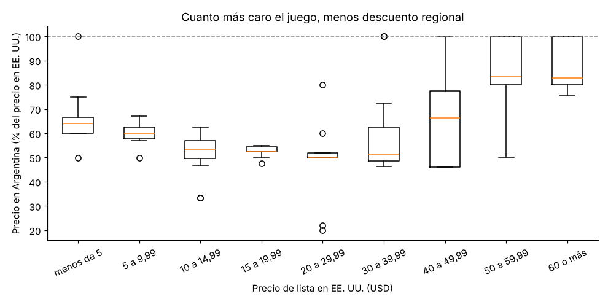
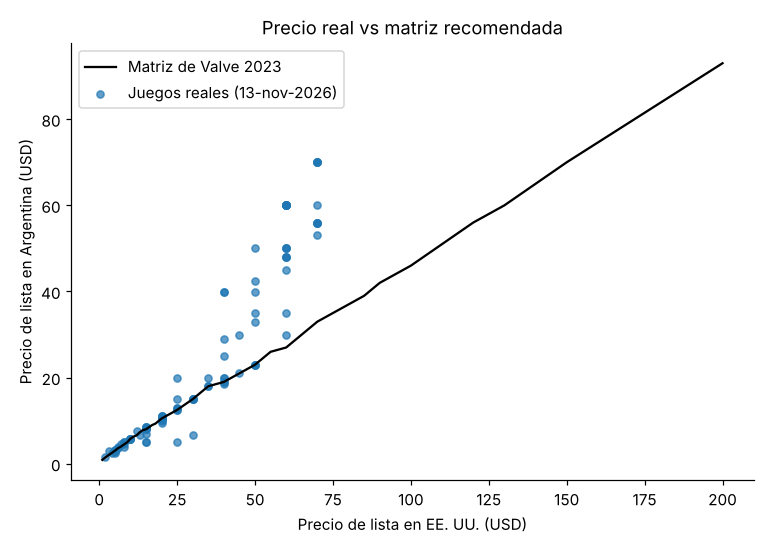
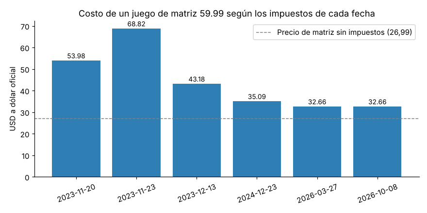

# Precios regionales de Steam y su impacto en Argentina

> **Resumen:** analicé cuánto pagan los argentinos por juegos en Steam, combinando las
> matrices de precios regionales de Valve (2020, 2022 y 2023), la cronología de impuestos y
> dólar de 2020 a 2026, una muestra de 105 precios reales del 13 de noviembre de 2026 y mis
> propias compras. Lo central: la matriz de Valve es solo una recomendación y cada editor
> fija su precio; en juegos de menos de 50 USD el precio argentino ronda la mitad del de
> EE. UU., pero en los de 50 USD o más casi no hay descuento; y los impuestos pesaron más
> que el precio regional: en noviembre de 2023 un juego costaba más del doble que su precio
> de matriz, y hoy el recargo es mucho menor.

## Preguntas que busca responder
- ¿Cuánto más barato es un juego en Argentina que en EE. UU.?
- ¿Los editores siguen la matriz de precios que recomienda Valve?
- ¿Cuánto pesaron los impuestos y el dólar en el precio final, a lo largo del tiempo?

## Datos
- **Matrices de Valve** (`data/matrices_valve.csv`): 2020 y 2022 en pesos, 2023 en dólares.
  Fuentes: [SteamDB](https://steamdb.info/blog/steam-turkey-argentina-usd/) y
  [Cultura Geek](https://culturageek.com.ar/steam-anuncia-nuevas-recomendaciones-en-precios-regionales-como-afecta-esto-a-argentina/).
  La matriz de 2026 no está publicada de forma abierta, así que no se usa.
- **Precios reales** (`data/precios_steam_2026-11-13.csv`): 105 juegos, leídos de la API
  de la tienda de Steam el 13-nov-2026 con precio de Argentina y de EE. UU.
- **Impuestos y dólar** (`data/impuestos_cronologia.csv`, `data/dolar_fechas_clave.csv`):
  con norma, fuente y nivel de confianza por fila.
- **Compras propias** (`data/compras_propias.csv`): 4 compras de 2026 y 1 recarga de 2022
  (recibos de Steam y resúmenes de la app de la tarjeta, sin datos personales).
- **Fuentes, conflictos y huecos** (`data/fuentes_conflictos_huecos.csv`): lo que no
  se pudo confirmar, anotado a propósito.

## Herramientas
Python (pandas, matplotlib), Jupyter, Git/GitHub.

## Estructura del repo
- `src/recolectar_precios.py`: baja la muestra de precios desde Steam (el único script)
- `notebooks/analisis.ipynb`: todo el análisis y los gráficos
- `data/`: datos (tablas chicas, incluidas en el repo)
- `images/`: gráficos del informe

## Cómo reproducirlo
1. Clonar el repo e instalar dependencias (PowerShell):
   ```
   git clone https://github.com/xdark-whisper/analisis-steam-argentina.git
   cd analisis-steam-argentina
   py -3.13 -m venv venv
   venv\Scripts\activate
   pip install -r requirements.txt
   ```
2. Abrir `notebooks/analisis.ipynb` en VS Code o Jupyter y ejecutar las celdas. Con los
   datos que trae el repo alcanza.
3. Opcional, para repetir la medición de precios con juegos nuevos: `python src/recolectar_precios.py`
   (tarda unos 5 minutos y crea un CSV nuevo en `data/`).

## Decisiones de la muestra
- Los juegos salen de la lista de más vendidos de Steam y se reparten en 9 rangos de precio
  de EE. UU., con 10 a 16 juegos por rango.
- Se usa el precio de lista (sin descuento) para comparar, y se anota el descuento aparte.
- Se compara contra el precio de EE. UU., que es el de referencia que usa Valve.
- Se ignoran los juegos gratis. Hay 105 juegos únicos; 3 aparecían repetidos y se
  eliminaron los duplicados.

## Hallazgos
### ¿Cuánto más barato es un juego en Argentina?
*Notebook: sección 1*



- La mediana del precio argentino es el 58% del precio de EE. UU.
- En juegos de menos de 50 USD la mediana va del 50% al 66% según el rango.
- En los de 50 a 59,99 USD sube al 83%, y 7 de 16 cuestan igual que en EE. UU.
  En los de 60 USD o más pasa lo mismo con 4 de 10.
- 15 de los 105 juegos cuestan lo mismo en Argentina que en EE. UU.
- Salvedades: es una muestra de los más vendidos, no de todo el catálogo; es una sola
  fecha; y cada editor puede cambiar su precio en cualquier momento.

### ¿Siguen los editores la matriz de Valve?
*Notebook: sección 2*



- Solo 29 de 101 juegos siguen exactamente la matriz de 2023. Hay 4 juegos sin
  tier de matriz que no se cuentan.
- Entre los juegos de menos de 50 USD la siguen 29 de 75 (5 de 9 en el rango más barato
  y 2 de 11 en el de 10 a 14,99).
- En los de 50 USD o más, **ninguno** (0 de 26). Un juego de lista 59,99 debería costar 26,99
  según la matriz: en la muestra cuestan entre 30,00 y 59,99.
- Conclusión: la matriz es un piso recomendado, no una regla.

### ¿Cuánto pesaron los impuestos?
*Notebook: sección 3*



Costo de un juego que sigue la matriz con base 59,99 (precio de matriz: USD 26,99),
expresado en dólares oficiales:

| Fecha | Carga impositiva | Norma | Costo en USD oficiales |
|---|---|---|---|
| 20-nov-2023 | 100% | RG 5232/2022 y RG 5430/2023 | 53,98 |
| 23-nov-2023 | 155% | RG 5450/2023 | 68,82 |
| 13-dic-2023 | 60% | RG 5463/2023 | 43,18 |
| 23-dic-2024 | 30% (termina el PAIS) | RG 5617/2024 | 35,09 |
| 27-mar-2026 | IVA 21% | RG 5677/2025 | 32,66 |
| 8-oct-2026 | IVA 21% | RG 5677/2025 | 32,66 |

- El peor momento fue noviembre de 2023: el comprador pagaba 2,55 veces el precio de matriz.
- El dólar oficial pasó de 372 a 820 pesos entre el 23-nov y el 13-dic-2023, en la devaluación de diciembre.
- La eliminación de la percepción del 30% para plataformas de juegos (RG 5677/2025,
  B.O. 16-abr-2025) es la norma que explica la baja de 2025.
- Salvedades: el cálculo supone un juego que sigue la matriz y toma el dólar de un solo
  día por período. Los impuestos de 2026 son un modelo; ver la sección siguiente.

### Mis compras reales (2026)
*Notebook: sección 4*

- Elden Ring a USD 31,19 coincide con el precio de lista argentino (47,99) menos un 35%
  de descuento (inferido: el recibo no muestra el descuento).
- Con una tarjeta de fintech (AstroPay), Steam cobró el precio exacto, sin línea de impuestos.
  La tarjeta sumó solo una comisión de 3,5% sobre el dólar oficial.
- Un intento de pago por otro descriptor del comercio (`STEAMGAMES.COM`) salía un 26%
  más caro que el que se completó (`WL *STEAM PURCHASE`). Es compatible con la percepción
  del 30%, pero con una sola observación es una hipótesis.
- Una recarga de 400 pesos en 2022 confirma que Steam facturaba en pesos en esa época.

## Limitaciones y lo que no se pudo confirmar
- **Antes de nov-2023** no se puede calcular el costo real en tarjeta: no se sabe a qué
  tipo de cambio convertía Valve el precio en pesos al cobrar en dólares.
- **IVA en 2026:** la prensa y Steamcito hablan de IVA 21%, pero mis compras con AstroPay
  no muestran IVA. Falta una compra con tarjeta de banco para confirmarlo.
- **PAIS 8% a 30%** (2021): solo lo sostiene Steamcito; no encontré la norma. Un artículo de
  2023 indica que los servicios digitales pagados en pesos tributaban 8% y los recreativos 30%;
  Steam parece haberse tratado como lo segundo, pero no lo pude confirmar.
- **Ingresos Brutos y sellos** provinciales: no se cuantificaron.
- **Matriz 2026:** solo se conoce el tier 59.99; no se puede comparar con los precios actuales.
- Todos los conflictos y huecos están en `data/fuentes_conflictos_huecos.csv`.

## Fuentes
SteamDB, Cultura Geek, Marval, Los Andes, Chequeado, iProUP, Rava, dolarhistorico.com,
indicadores.ar y el código abierto de la extensión Steamcito. El detalle por dato está en
`data/impuestos_cronologia.csv` y `data/dolar_fechas_clave.csv`.
